# ha-ent-educartable

[](https://www.home-assistant.io/integrations/marketplace/)
[](https://github.com/juju35/ha-ent-educartable/actions/workflows/hacs.yml)
[](https://github.com/juju35/ha-ent-educartable/actions/workflows/validate.yml)
[](https://github.com/juju35/ha-ent-educartable/actions/workflows/lint.yml)
[](https://github.com/juju35/ha-ent-educartable/releases/latest)
[](https://github.com/juju35/ha-ent-educartable/blob/main/LICENSE)
[](https://buymeacoffee.com/julienstep9)

<p align="center"></p>

<p align="center"></p>

Home Assistant integration for **Educartable**, the family portal of EDUMOOV used by many French primary schools: homework of every child, liaison book to sign and school news, with a Lovelace card and a sidebar panel included.

[](https://my.home-assistant.io/redirect/marketplace_repository/?owner=juju35&repository=ha-ent-educartable&category=integration)

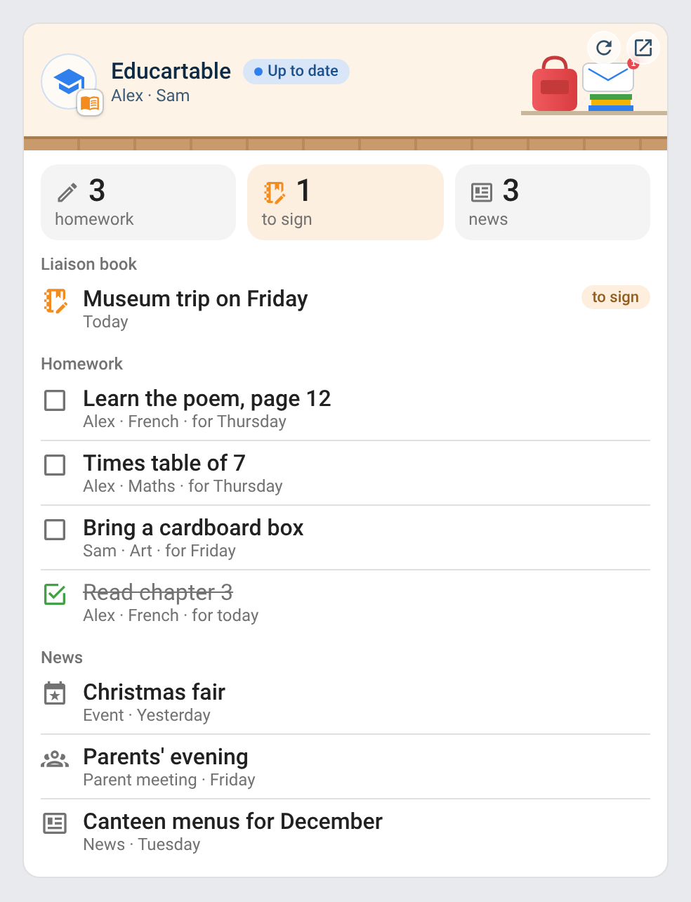

> [!IMPORTANT]
> Unofficial community project, neither made nor endorsed by EDUMOOV or Educartable. The portal has no public API: the integration calls the routes its web application uses, and a portal update can break it. This release only **reads** the portal.

## Features

- One device per child with a **Homework to do** sensor: the count, with the homework (title, subject, due date, done) as attributes
- **Liaison book to sign** sensor (messages still to sign, across all children) and **News** sensor (news, events and parent meetings)
- **Last update** sensor with the children and the panel options, read by the card and the panel
- `educartable.refresh` action to read the portal now
- `custom:educartable-card` card, **shipped with the integration** and loaded automatically: counts, liaison book to sign, homework of every child and news
- `custom:educartable-mini-card` compact card: the counts, with a button to open the full card
- **Educartable sidebar panel** with Home, Homework, Liaison book, News and Settings tabs, and a badge on its sidebar entry counting what there is to deal with
- Username and password stored in the entry or read from `secrets.yaml` at every update; optional two-factor code
- English, French, German, Spanish, Serbian (Cyrillic and Latin), Italian, Dutch, Portuguese, Polish, Romanian, Danish, Swedish, Bulgarian, Russian, Ukrainian, Hungarian, Slovak, Czech, Slovenian, Latvian and Greek

## Supported integrations

<p></p>

This integration talks directly to the EDUMOOV family portal, so it needs no other Home Assistant integration; the card and the panel read its own sensors only.

- [Educartable — portail familles](https://www.educartable.com/) (EDUMOOV)

## Prerequisites

- Home Assistant 2026.6 or later
- An Educartable family account (username, often your email, and password, given by the school)

## Installation

### Via the Marketplace (recommended)

Click the button below to add the repository directly:

[](https://my.home-assistant.io/redirect/marketplace_repository/?owner=juju35&repository=ha-ent-educartable&category=integration)

Then click **Install** and restart Home Assistant.

Or manually:

1. Open **Settings → Marketplace → Add from link** (top right; this needs a GitHub account connected)
2. Add `https://github.com/juju35/ha-ent-educartable` — Type: **Integration**
3. Open **Educartable** and click **Install**
4. Restart Home Assistant

The card is **part of the integration**: at startup it is added to the dashboard resources (`/educartable_static/educartable-card.js`, module). After an install or an update, restart Home Assistant and refresh the browser (clear the companion app cache if needed). If your dashboards are in YAML mode, the card is loaded on every page without going through the resources.

### Manual

Copy `custom_components/educartable/` to `/config/custom_components/educartable/`, then restart Home Assistant.

## Configuration

### Integration

[](https://my.home-assistant.io/redirect/config_flow_start/?domain=educartable)

**Settings → Devices & services → Add integration → Educartable**, then enter the username (often your email) and password given by the school. If your account uses two-factor authentication, enter the current one-time code as well.

#### Username and password in secrets.yaml

To keep the credentials out of the config entry, leave the username/password fields empty and give the name of a `secrets.yaml` entry instead:

```yaml
# secrets.yaml
educartable_username: "parent@example.com"
educartable_password: "your-password"
```

The secrets are read again at every update: after a password change, editing the secret is enough.

#### Options

**Settings → Devices & services → Educartable → Configure** (or the panel's Settings tab):

- **Update interval** — Educartable is shared by the whole school, so 10 minutes is the minimum.
- **Homework window** — homework due within this many days is shown.
- **Show the Educartable panel in the sidebar** — on by default.
- **Tabs shown in the panel** — Homework, Liaison book, News: a hidden tab also leaves the home page.
- **Hide the top bar** — *No*, *For everyone* or *For non-admins*: the tabs stay alone at the top of the panel.

### Card

Add the **Educartable** card from the card picker: every option is set in the visual editor. In YAML:

```yaml
type: custom:educartable-card
```

| Option | Default | Description |
|---|---|---|
| `config_entry_id` | first account | Educartable account to show (useful with several accounts) |
| `title` | `Educartable` | Card title |
| `show_title` | `true` | Show the title in the header |
| `show_refresh` | `true` | Show the refresh button |
| `show_words` | `true` | Show the liaison book messages to sign (section and count) |
| `show_homework` | `true` | Show the homework (section and count) |
| `show_done` | `true` | Show the homework already done (after the rest, struck through) |
| `show_news` | `true` | Show the news, events and parent meetings (section and count) |
| `show_empty` | `false` | Keep the sections with nothing to show (the homework section always stays) |
| `max_items` | `5` | Items per section |
| `illustration` | `true` | Illustrated header: a school corner (schoolbag, exercise books, the envelope of the liaison book to sign or the sheet of the homework) on the card's background, the school icon in the status colour (blue: things to deal with, grey: all done, amber: partly updated, red: unavailable); `false` keeps the classic header |
| `illustration_theme` | `auto` | `auto` (follows the Home Assistant theme: night with a dark theme, day with a light theme), `day` or `night` |
| `language` | Auto | Force language: `en`, `fr`, `de`, `es`, `sr`, `sr-Latn`, `it`, `nl`, `pt`, `pl`, `ro`, `da`, `sv`, `bg`, `ru`, `uk`, `hu`, `sk`, `cs`, `sl`, `lv` or `el` (auto-detects from HA settings) |

With two children or more, each homework says whose it is. A count opens the panel on its tab (or, without the panel, scrolls the card to its section). The open button opens the Educartable portal in a new tab. This release only reads the portal: messages to sign and homework show their state, without buttons acting on it.

### Mini card

A compact card for dashboards: homework to do, liaison book to sign and news. The button at the top right opens the full card in place; a click outside the card folds it back.

```yaml
type: custom:educartable-mini-card
```

It takes the same options as `custom:educartable-card` (both: set in the same visual editor); they apply to the full view.


### Panel

The **Educartable** entry of the sidebar opens a panel under the card's illustrated header (school corner, status in the icon's colour, refresh and open buttons), one tab per part of the portal (the tab is kept in the address):

| Tab | Content |
|---|---|
| Home | A child filter (with two children or more), the school week (homework left per day; a click keeps only that day), tiles for the liaison book, homework and news (count as badge, coloured state line), then *To do* (messages to sign, homework) and the news |
| Homework | The child filter, then one box per due day with its progress (done / total); done ones can be hidden |
| Liaison book | The messages still to sign first, then the signed ones |
| News | News, events and parent meetings |
| Settings | The account options; only administrators can change them |

With several accounts, a menu at the right of the tabs switches between them. The child filter and *Hide done* are remembered in the browser, and the tabs can be browsed with the arrow keys. On scroll, the top bar folds into a compact sticky bar with round icon tabs.

### Action

`educartable.refresh` reads the portal now. With several accounts, add `config_entry_id`.

### Diagnostics

**Settings → Devices & services → Educartable → ⋮ → Download diagnostics** gives the options and the number of items of each kind; the credentials are redacted.

## Screenshots

### Animations

The illustrated header of the card and of the panel plays what is waiting: with a message to sign the envelope bobs and its count blinks; with homework left (everything signed), the pen writes on the sheet. When everything is done, the ticked sheet stays still. Animations stop when the system asks for reduced motion.

Card header, liaison book to sign and homework left:

| Light | Dark |
|---|---|
|  | 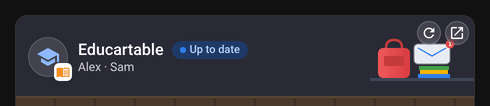 |
|  |  |

Panel header, liaison book to sign and homework left:

| Light | Dark |
|---|---|
|  | 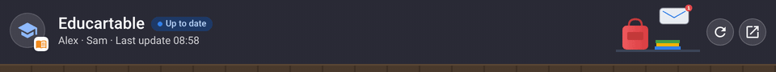 |
| 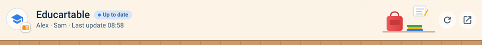 | 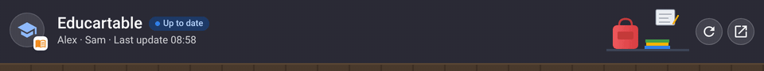 |

While the portal is read, the refresh button spins until the update finishes.

| Light | Dark |
|---|---|
| 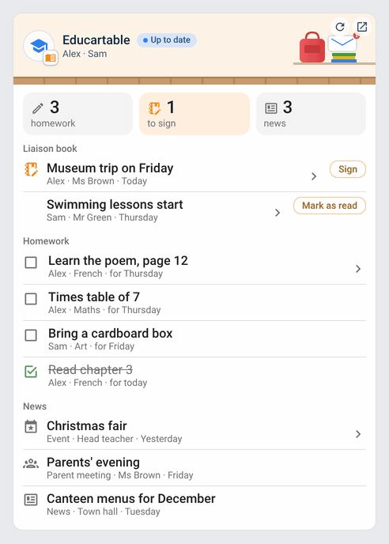 |  |

### Card

| Light | Dark |
|---|---|
|  | 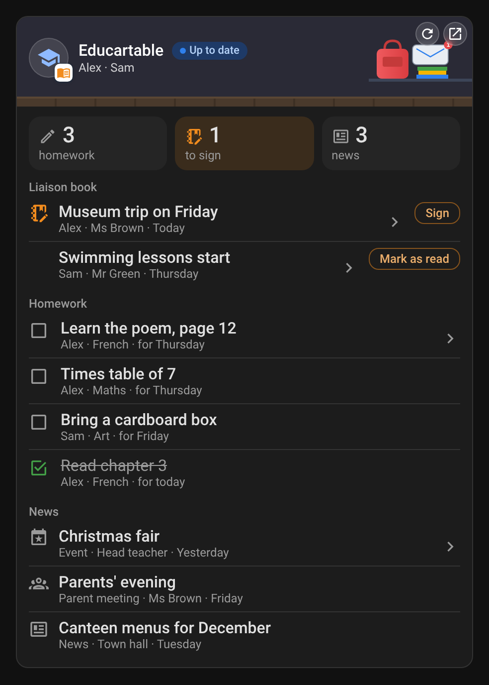 |

The mini card, then expanded by its detail button:

| Light | Dark |
|---|---|
|  | 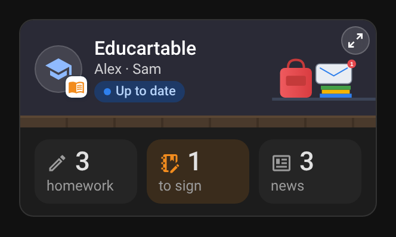 |
|  |  |

The sidebar entry, with a badge counting what there is to deal with (messages to sign and homework to do):

| Light | Dark |
|---|---|
| 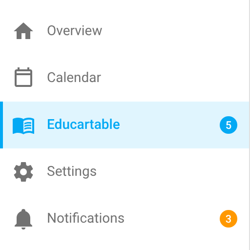 | 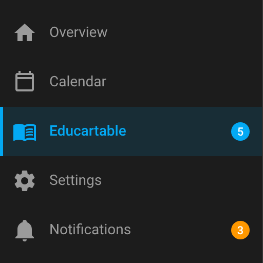 |

### Panel

Home (child filter, week, tiles, To do and news), the same with the top bar hidden, Homework (one box per day with its progress), Liaison book and News:

| Light | Dark |
|---|---|
|  |  |
| 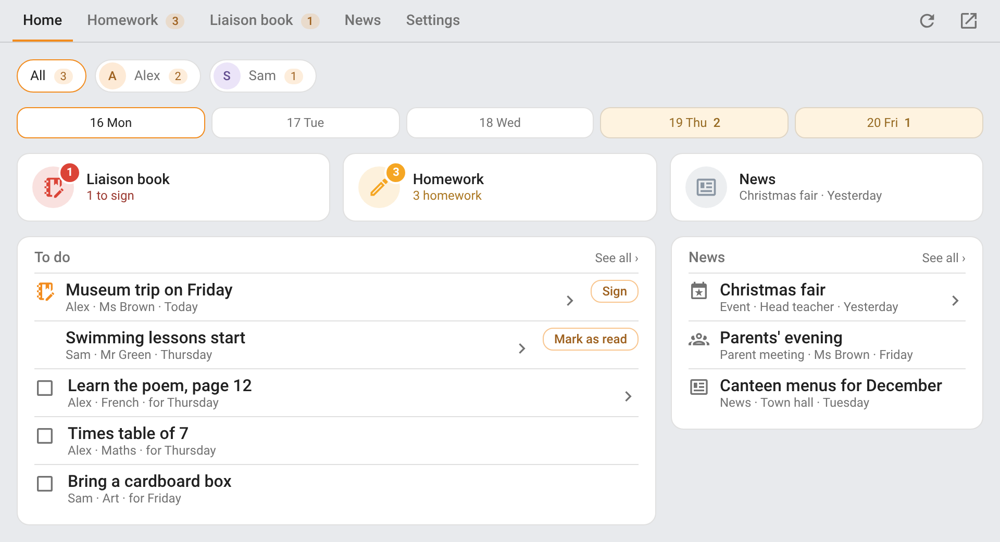 |  |
| 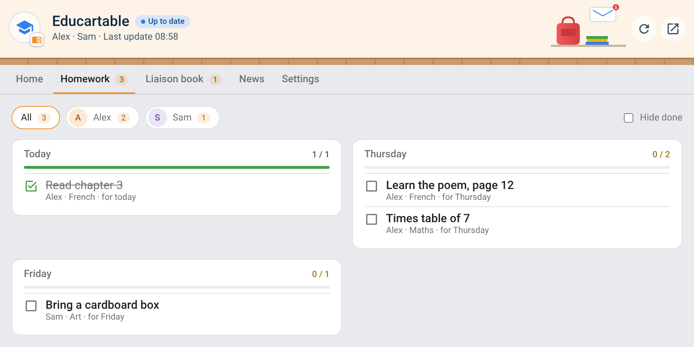 |  |
| 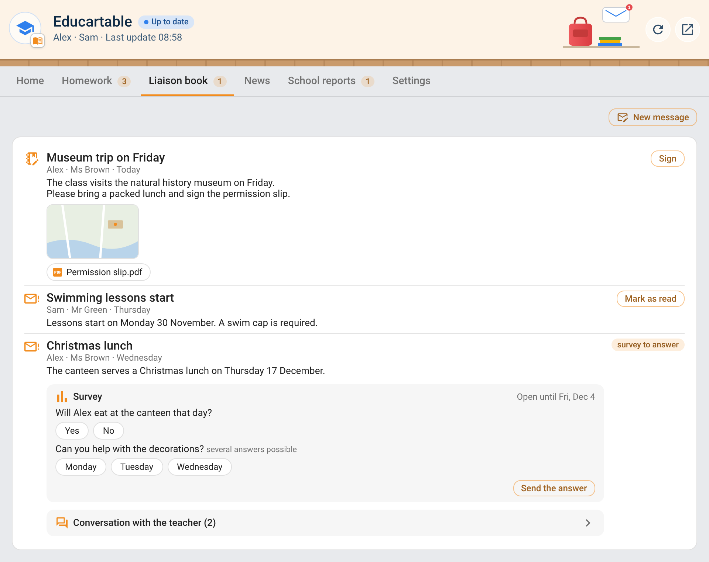 |  |
| 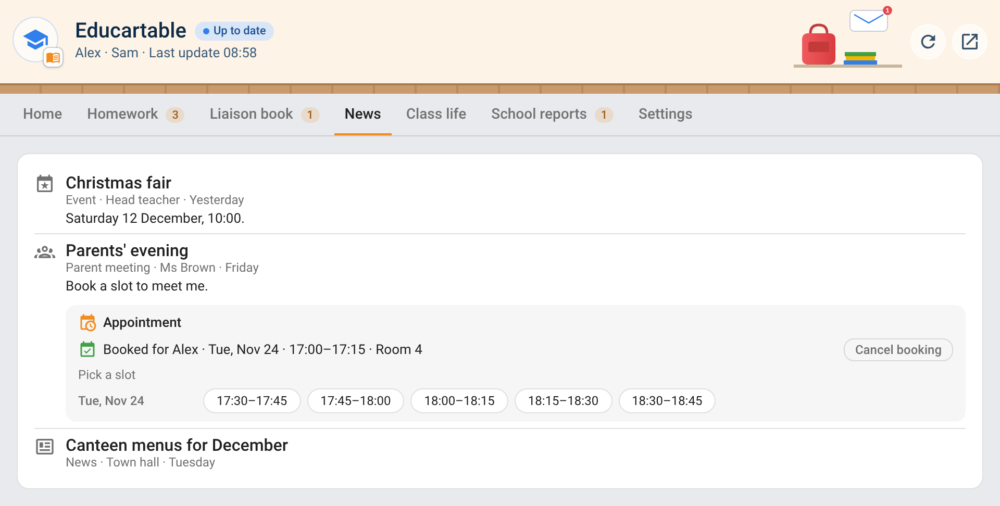 |  |

## Roadmap

Planned once validated on a real parent account (network capture): signing the liaison book, marking homework done, replying to messages, answering surveys, attachment downloads and the pupil *livret / compétences*.

## Support

If this is useful to you, you can [buy me a coffee](https://buymeacoffee.com/julienstep9). Issues and ideas are welcome on the [issue tracker](https://github.com/juju35/ha-ent-educartable/issues).
